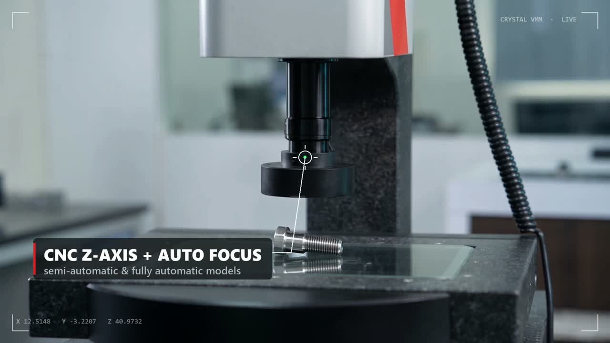

# Armatech Associates: "Crystal" AI-assisted marketing

Marketing assets for **Armatech Associates** (MIDC Bhosari, Pune, est. 1980), which makes the *Crystal* range of magnetic and non-magnetic workholding. I made them with generative-AI tools (Higgsfield, image models) and finished them with code: Python/PIL compositing and ffmpeg.

## ▶ Watch the promo

**[▶ Play the video in your browser](https://aal7221-maker.github.io/armatech-crystal-marketing/)** (49 s, 1080p). GitHub's file viewer can't play MP4 files, so the video is hosted on GitHub Pages.

## Contents

| Folder | What's inside |
|---|---|
| [`vmm-promo-video/`](vmm-promo-video) | **Crystal Vision Measuring Machine promo.** The final cut is `VMM_promo_v7_1080p.mp4`, with 720p and WhatsApp-sized versions alongside. |
| [`imtex-2027-marketing-kit/`](imtex-2027-marketing-kit) | IMTEX 2027 exhibition kit: invitations, product ads, product enquiry cards, a 15 s promo, a slideshow, an 11-page marketing playbook and an enquiry page. Open `START-HERE.html`. |
| [`website/`](website) | A static enquiry and invitation web page. |
| [`magnetic-v-block-explainer/`](magnetic-v-block-explainer) | A diagram and animation of how a magnetic V-block switches on and off. |

## How the VMM promo was made

1. **References:** product photos of the five VMM models (manual, semi-auto, full-auto, cabinet, VMS) and the Crystal logo are in `references/`.
2. **Higgsfield generation:** a 30 s cinematic sweep showing the granite base, telecentric zoom optics, dual lighting paths and linear scales. The raw output is `higgsfield/raw-generation-30s.mp4`, and the prompts and job IDs are in `higgsfield/prompts-and-jobs.txt`.
3. **Stills and close-ups:** one still per model plus detail close-ups, in `stills/`.
4. **Edit:** `scripts/edit_hd.py` renders the layout (text, callouts, UI overlays and an animated logo from `logo_anim.py`) natively at 1080p, then ffmpeg cuts, mixes music and encodes the result. There were seven iterations (v1 to v7), and v7 is final.

The scripts hard-code the paths to ffmpeg and the Windows fonts. Change the constants at the top of each script before running it.

## Tools
Higgsfield AI · image-generation models · Python (Pillow, NumPy) · ffmpeg · Claude Code / Codex
